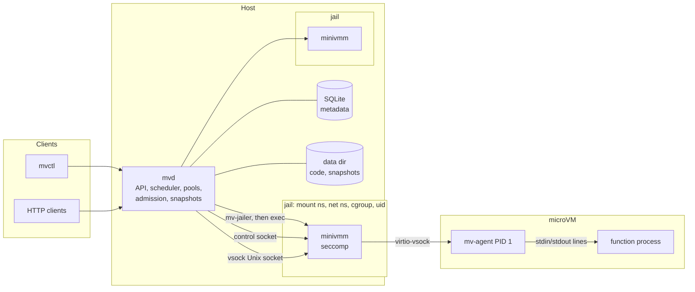
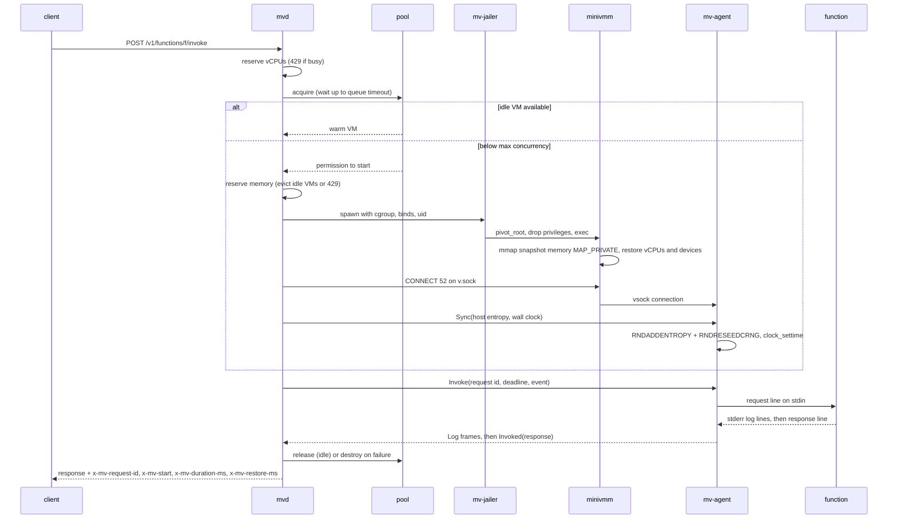
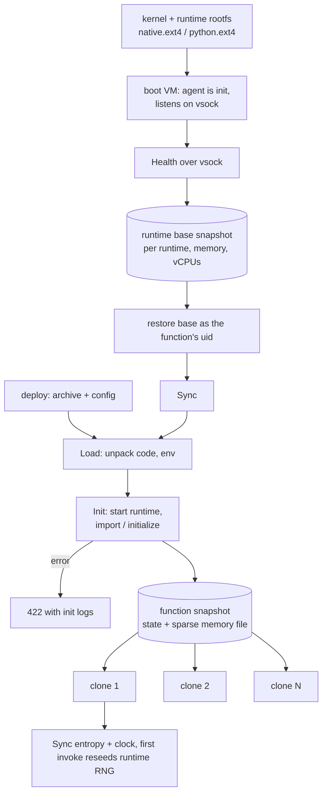

# Architecture

The platform turns a small KVM VMM into a Lambda-style function service. Every invocation
runs in its own microVM, restored copy-on-write from a snapshot taken after the function
finished initializing, so a cold start skips both kernel boot and function init.

## Components

| Crate | Role |
|---|---|
| `minivmm` | The VMM: KVM, virtio-blk/net/vsock over PCI, snapshots, seccomp. One process per VM. |
| `mv-proto` | Shared types: the framed host-agent protocol, the function line protocol and the HTTP API types. |
| `mv-agent` | Static musl binary that runs as PID 1 in the guest; loads code, runs init, invokes, streams logs, reseeds entropy and sets the clock. |
| `mvd` | The daemon: HTTP API, per-function warm pools, admission control, snapshot builder, VMM supervision, jail and cgroups, persistence, metrics. Ships `mv-jailer`. |
| `mvctl` | CLI for deploy, invoke, logs, list, describe, delete, status and a load generator (`bench`). |

## Invoke path

Failures are contained to the request: the agent call has the function timeout, and the VMM
process is watched at the same time. A timeout, a guest panic, an agent error or a killed
VMM fails only that request (504 or 502); the VM is destroyed (cgroup killed, jail and
cgroup removed) and the next request cold-starts a fresh clone.

## Snapshot lifecycle

- **Base snapshots** are built lazily, once per (runtime, memory size, vCPU count), and
  rebuilt when the kernel or runtime image changes (a manifest records file identities).
- **Function snapshots** are built on every deploy into `functions/<id>/rev-<n>/`; older
  revisions are removed once the new one is live. On startup, a function whose runtime image
  changed is rebuilt from its stored code.
- **Memory files** are sparse (all-zero pages are holes) and mapped `MAP_PRIVATE`, so clones
  share every page they do not write through the page cache.

## Key decisions and trade-offs

- **One VMM process per VM, jailed.** A VMM compromise is confined to a mount namespace whose
  root holds only that VM's snapshot files, rootfs and a private `/dev/kvm` node, an empty
  network namespace, a per-function uid (VMs of different functions cannot signal or read each
  other), a cgroup with memory, CPU and pid limits, and the VMM's own seccomp filters. The
  cost is a fork, a few mounts and an exec per cold start (a few milliseconds).
- **Copy-on-write restore instead of reading memory.** Restoring maps the memory file instead
  of copying it, so restore time does not grow with guest memory and idle clones cost only
  the pages they touched. The trade-off is that the first touch of each page is a page fault.
- **vsock only.** The guest has no network device; the agent is reachable only through the
  VMM's vsock Unix socket. Functions therefore cannot open network connections.
- **Agent as PID 1.** No init system and no shell in the boot path; the agent mounts the
  pseudo filesystems, reaps orphans and owns the function process. If it dies, the kernel
  panics and the VM is replaced, which is exactly the failure handling we want.
- **Line protocol for functions.** Native functions only need to read JSON lines and write
  JSON lines; Python reuses the same protocol through a small bootstrap that imports the
  handler once during init (so imports are captured in the snapshot).
- **Entropy and clock after restore.** Clones share the snapshot's kernel RNG state and wall
  clock. The host sends 64 bytes of fresh entropy and the current time on every new
  connection; the agent feeds them to `RNDADDENTROPY`, forces `RNDRESEEDCRNG` and calls
  `clock_settime`. The first invocation after a restore carries `reseed: true` so runtimes
  can reseed user-space generators (the Python bootstrap calls `random.seed()`).
- **One request per VM, warm pool per function.** Like Lambda, a VM serves one request at a
  time; concurrency comes from more VMs, capped by `max_concurrency`. Requests above the cap
  wait for a VM up to the queue timeout, then get 429.
- **Admission control.** Each live VM reserves its cgroup memory limit (guest memory plus
  overhead) against a host limit, and each running invocation reserves its vCPUs. When memory
  runs out, the oldest idle VMs (of any function) are evicted first; only then is the request
  refused with 429. `MemAvailable` below the reserve also refuses new VMs. Reservations are
  conservative because CoW makes real usage much lower; `--memory-overcommit` relaxes them.
- **Scale to zero.** A reaper destroys VMs idle longer than `--idle-timeout`; a function with
  no traffic holds no memory beyond its snapshot files on disk.
- **SQLite for metadata, files for everything else.** Metadata changes are rare and small;
  code and snapshots are large immutable files written atomically per revision.
- **Snapshots are taken with the host connection closed.** Host Unix sockets cannot be part of
  a snapshot, so the VMM sends a vsock `TRANSPORT_RESET` after restore. Host connections
  made meanwhile are held back until the guest re-posts its event buffer, which Linux does only
  after it has dropped every stale socket, so the reset cannot kill a new connection.
